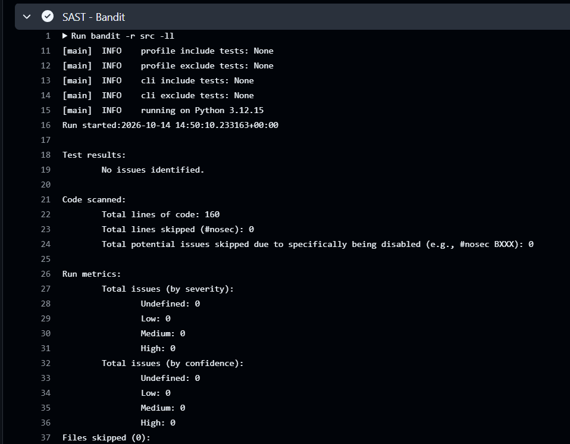
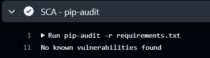

# Информационная безопасность. Лабораторная работа №1

Разработка защищённого REST API с интеграцией в CI/CD.

## Стек

- Python 3.12 / Flask
- SQLAlchemy (ORM) + SQLite
- PyJWT — JWT-токены
- bcrypt — хэширование паролей
- CI/CD: GitHub Actions (bandit — SAST, pip-audit — SCA)

## Запуск

```bash
python -m venv .venv
source .venv/bin/activate      # Windows: .venv\Scripts\activate
pip install -r requirements.txt
python run.py                  # сервер на http://127.0.0.1:5000
```

Запуск тестов и проверок безопасности локально:

```bash
pip install pytest bandit pip-audit
pytest -v
bandit -r src -ll
pip-audit -r requirements.txt
```

## Описание API

### `POST /auth/register` — регистрация пользователя (собственный метод)

Принимает логин и пароль, создаёт учётную запись.

```bash
curl -X POST http://127.0.0.1:5000/auth/register \
  -H "Content-Type: application/json" \
  -d '{"login": "alice", "password": "password123"}'
```

```json
{ "id": 1, "login": "alice" }
```

### `POST /auth/login` — аутентификация

Принимает логин и пароль, возвращает JWT-токен.

```bash
curl -X POST http://127.0.0.1:5000/auth/login \
  -H "Content-Type: application/json" \
  -d '{"login": "alice", "password": "password123"}'
```

```json
{ "token": "eyJhbGciOiJIUzI1NiIs..." }
```

### `GET /api/data` — получение данных

Возвращает список заметок. Доступ **только** у аутентифицированных пользователей —
требуется заголовок `Authorization: Bearer <token>`.

```bash
curl http://127.0.0.1:5000/api/data \
  -H "Authorization: Bearer <token>"
```

```json
[ { "id": 1, "author": "alice", "content": "hello" } ]
```

Без токена или с невалидным токеном эндпоинт возвращает `401 Unauthorized`.

### `POST /api/data` — создание заметки

Создаёт заметку от имени текущего пользователя. Так же защищён JWT.

```bash
curl -X POST http://127.0.0.1:5000/api/data \
  -H "Authorization: Bearer <token>" \
  -H "Content-Type: application/json" \
  -d '{"content": "hello"}'
```

## Реализованные меры защиты

### Защита от SQL-инъекций (SQLi)

Все обращения к базе данных идут через ORM SQLAlchemy с параметризованными
запросами. Конкатенация строк для формирования SQL не используется нигде —
пользовательский ввод всегда передаётся как параметр, а не как часть текста
запроса.

```python
# src/app.py
user = User.query.filter_by(login=login).first()
```

### Защита от XSS

Любые пользовательские данные экранируются (`markupsafe.escape`) перед выдачей
в ответах API. Данные хранятся в БД в исходном виде, а опасные символы
(`<`, `>`, `&`, кавычки) превращаются в HTML-сущности при сериализации ответа.

```python
# src/app.py — GET /api/data
return jsonify([
    {
        "id": note.id,
        "author": str(escape(note.author.login)),
        "content": str(escape(note.content)),
    }
    for note in notes
])
```

Так, заметка `<script>alert(1)</script>` возвращается как
`&lt;script&gt;alert(1)&lt;/script&gt;` и не исполняется в браузере.

### Защита аутентификации (Broken Authentication)

- **Хэширование паролей.** Пароли никогда не хранятся в открытом виде — только
  bcrypt-хэш (соль генерируется автоматически и входит в хэш).

  ```python
  # src/auth.py
  def hash_password(password: str) -> str:
      return bcrypt.hashpw(password.encode(), bcrypt.gensalt()).decode()
  ```

- **JWT-токен выдаётся при успешном логине** (алгоритм HS256, ограниченный срок
  жизни `exp`).

  ```python
  # src/auth.py
  payload = {"sub": str(user.id), "login": user.login, "iat": now,
             "exp": now + timedelta(seconds=JWT_EXPIRES_IN)}
  return jwt.encode(payload, SECRET_KEY, algorithm="HS256")
  ```

- **Middleware проверки токена** на всех защищённых эндпоинтах. Декоратор
  `@jwt_required` читает токен из `Authorization: Bearer`, проверяет подпись и
  срок действия; при ошибке возвращается `401`.

  ```python
  # src/auth.py
  @app.get("/api/data")
  @jwt_required
  def get_data():
      ...
  ```

- При неверном логине и при неверном пароле возвращается одинаковый ответ
  `401 invalid credentials` — это не раскрывает факт существования учётной записи.

## Отчёты из pipeline (SAST / SCA)

При каждом `push` и `pull request` GitHub Actions запускает тесты и
security-сканеры (см. [.github/workflows/ci.yml](.github/workflows/ci.yml)).

**SAST — bandit** (статический анализ кода):



**SCA — pip-audit** (проверка зависимостей на известные уязвимости):



## Последний успешный запуск pipeline

https://github.com/LumberJack14/infosec-1/actions/runs/38584012893
